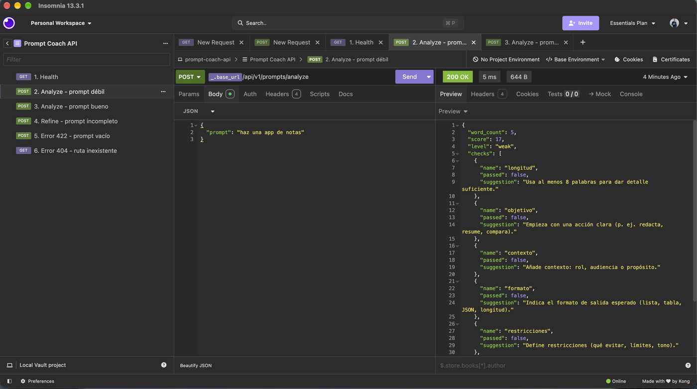
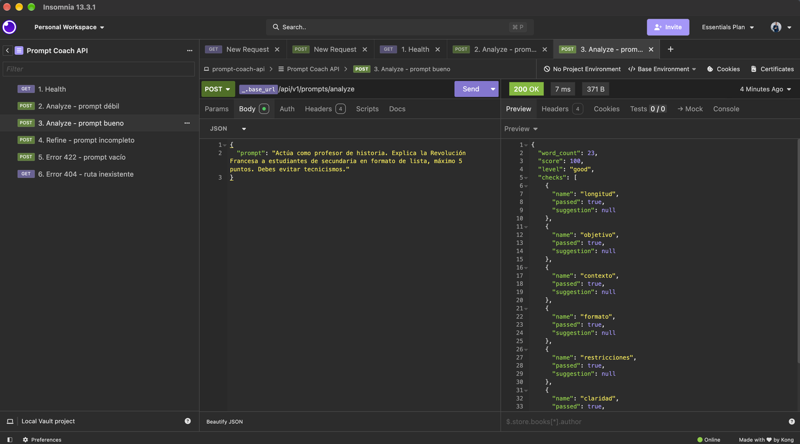
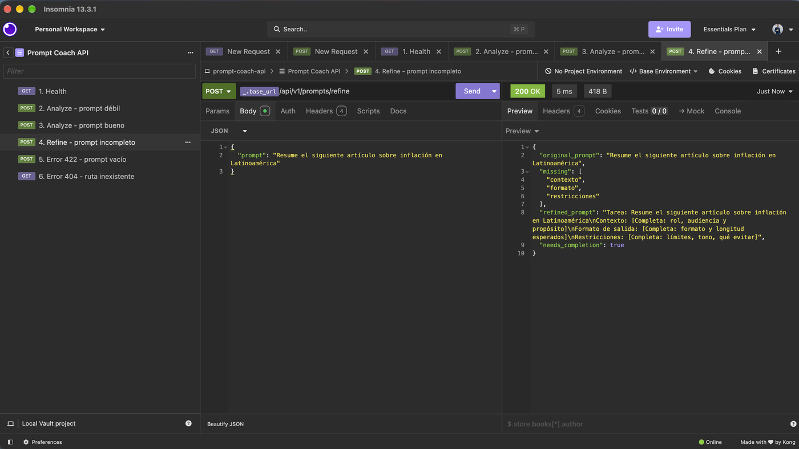
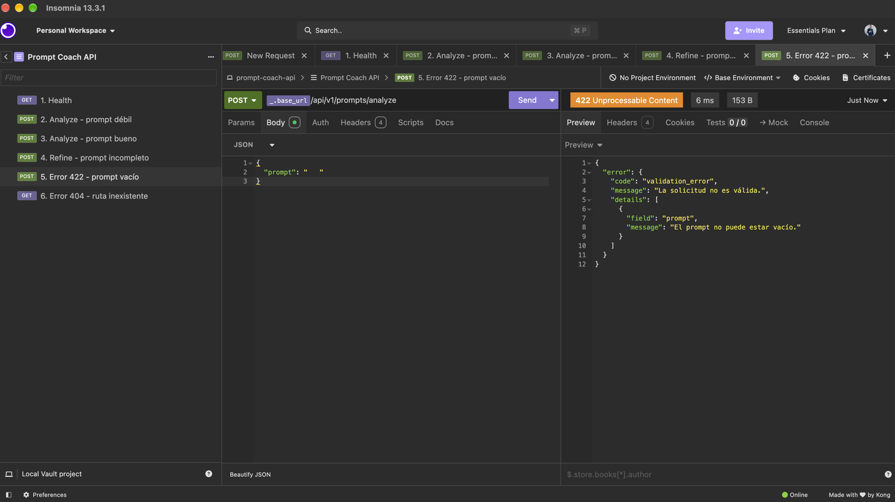
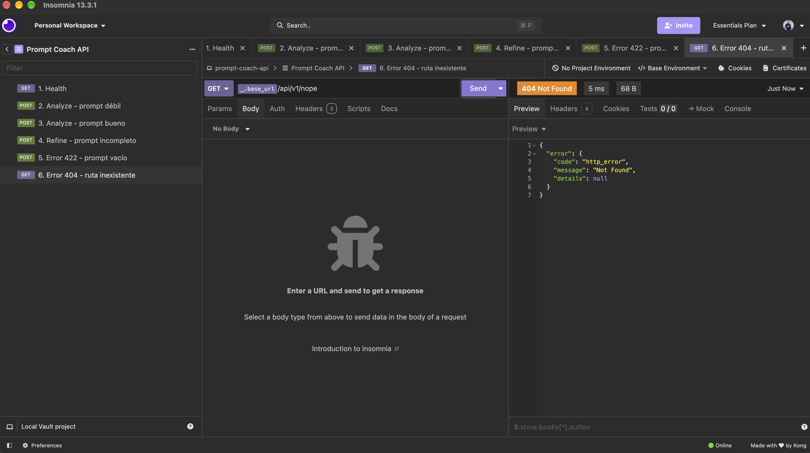
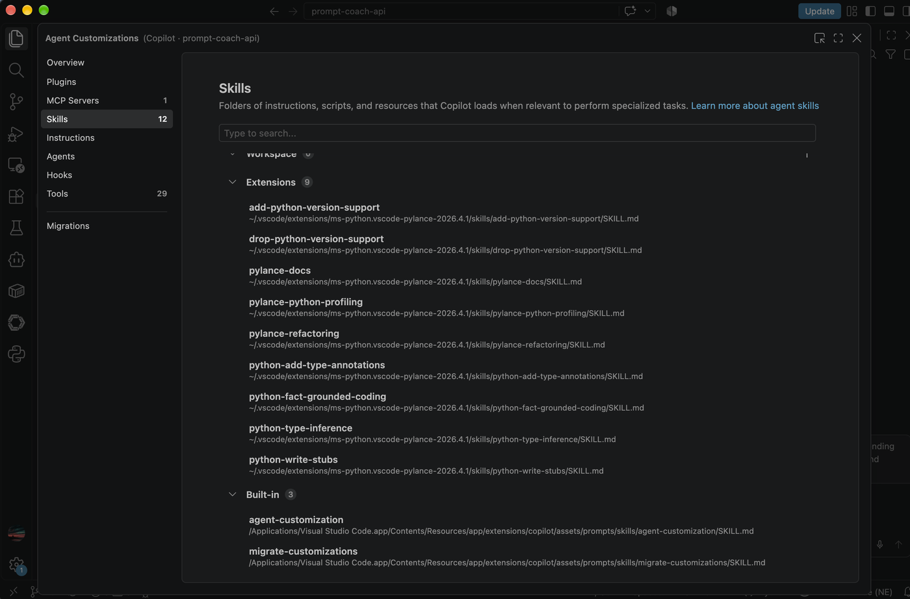
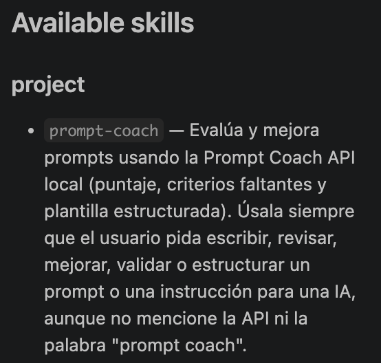
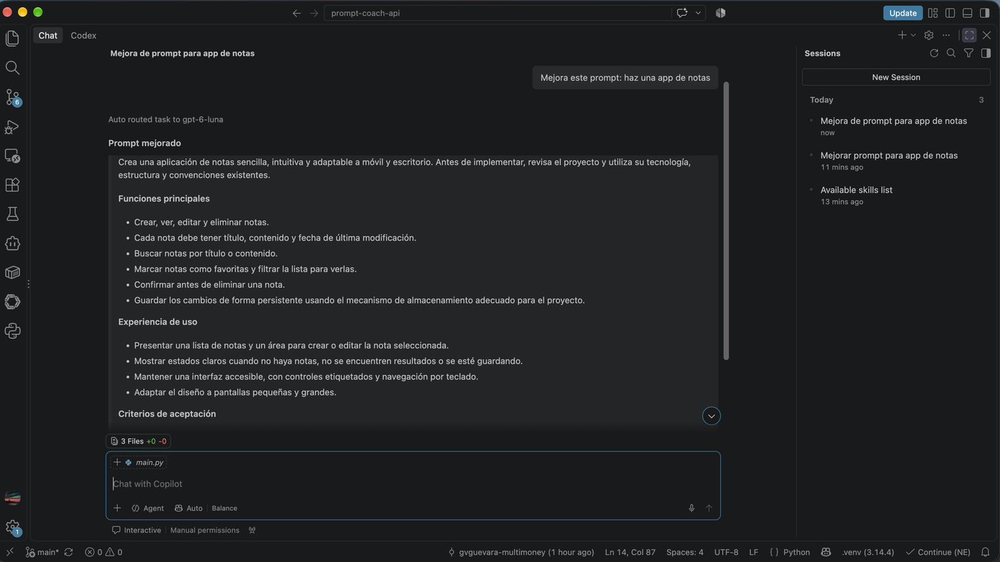
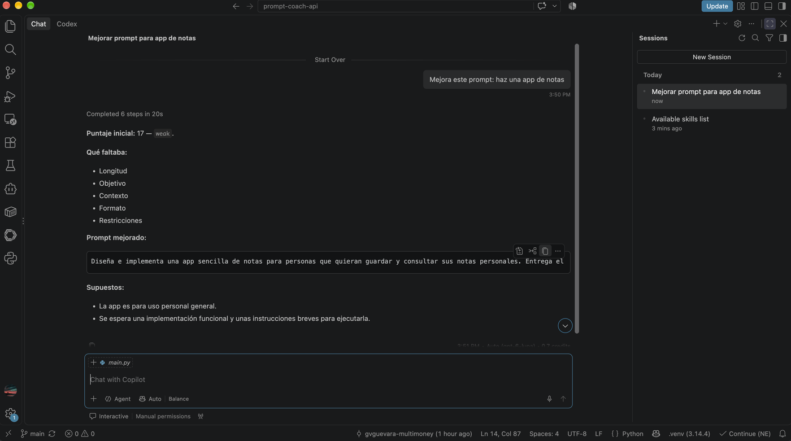
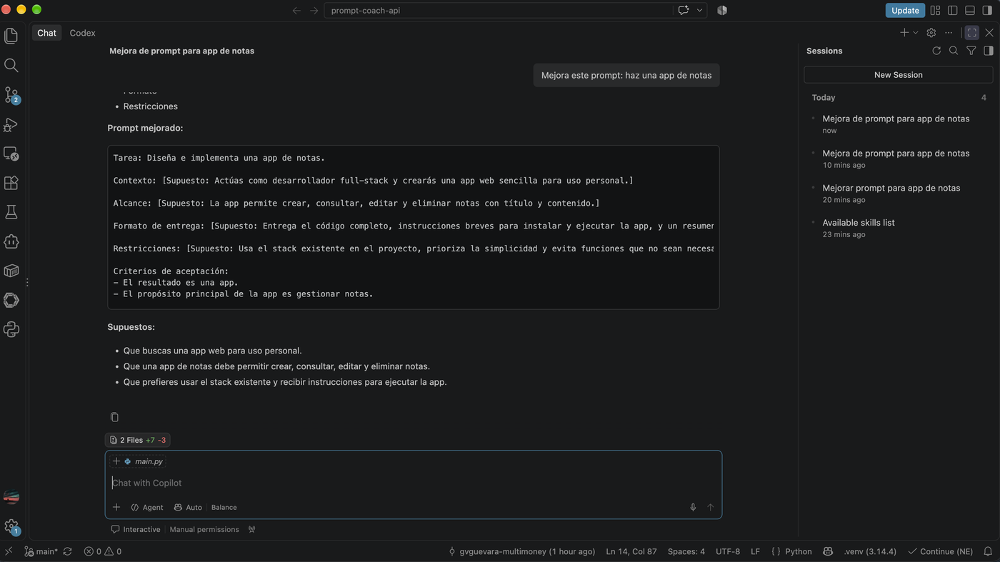

# Prompt Coach API

API mínima con **FastAPI** que evalúa la calidad de un prompt con reglas deterministas
(sin LLM) y lo estructura, más una **skill propia** (`.github/skills/prompt-coach/`) que
hace que un agente use esa API antes de responder pedidos sobre prompts.

## 1. Funcionalidad de la API

| Método | Ruta | Descripción |
|---|---|---|
| GET | `/api/v1/health` | Estado y versión |
| POST | `/api/v1/prompts/analyze` | Puntaje 0-100, nivel (`weak`/`acceptable`/`good`) y sugerencias por criterio |
| POST | `/api/v1/prompts/refine` | Prompt estructurado con las secciones faltantes marcadas como `[Completa: ...]` |

Criterios evaluados: longitud, objetivo, contexto, formato, restricciones y claridad
(detalle en `.github/skills/prompt-coach/references/criteria.md`). La evaluación es
heurística (palabras clave en español e inglés).

Ejemplo:

```bash
curl -X POST http://127.0.0.1:8000/api/v1/prompts/analyze \
  -H "Content-Type: application/json" \
  -d '{"prompt": "Resume este artículo sobre inflación en 5 viñetas, máximo 80 palabras."}'
```

Errores: formato único `{"error": {"code", "message", "details"}}` (422 validación, 404/405 HTTP, 500 interno).
Documentación interactiva en `http://127.0.0.1:8000/docs`.

## Ejecución (Python 3.10+)

```bash
python3 -m venv .venv && source .venv/bin/activate   # Windows: python -m venv .venv && .venv\Scripts\activate
pip install -r requirements-dev.txt
uvicorn app.main:app --reload
pytest
```

Variables opcionales: `PROMPT_MIN_WORDS` (8), `PROMPT_MAX_CHARS` (4000), `PROMPT_GOOD_SCORE` (80).

## Estructura

```
app/
  main.py      # crea la app, registra router y errores
  routes.py    # endpoints (solo HTTP)
  services.py  # lógica de negocio (reglas de evaluación)
  schemas.py   # modelos Pydantic y validaciones
  config.py    # configuración por variables de entorno
  errors.py    # manejo de errores centralizado
tests/         # lógica de servicio y endpoints
docs/          # capturas de evidencia
.github/skills/prompt-coach/
  SKILL.md
  scripts/call_api.py
  references/criteria.md
```

No hay capa de acceso a datos: la API es sin estado y no usa base de datos.

## 2. Propósito y funcionamiento de la skill

`prompt-coach` enseña al agente a **medir antes de opinar**. Cuando el usuario pide escribir
o mejorar un prompt, el agente:

1. Verifica que la API esté arriba y llama a `analyze`.
2. Si el nivel es `good`, entrega el prompt tal cual; si no, llama a `refine`.
3. Completa los huecos: usa los datos del usuario y, para todo lo que él no dijo, escribe
   el valor **dentro del prompt con la etiqueta `[Supuesto: ...]`** (máximo 3 preguntas).
4. Agrega una sección de **Criterios de aceptación** derivada solo del pedido original.
5. Responde con un formato fijo: puntaje inicial, qué faltaba, prompt mejorado y supuestos.

El `description` del `SKILL.md` define cuándo se activa; `scripts/` y `references/` se
cargan solo si hacen falta.

## 3. Cómo la skill modifica el comportamiento del agente

| | Sin skill | Con skill |
|---|---|---|
| Evaluación | Criterio propio, sin medir | Llama a la API y reporta un puntaje reproducible |
| Alcance | Agrega funciones no pedidas como si fueran requisitos | Todo lo no pedido va etiquetado como `[Supuesto: ...]` |
| Formato | Libre | Fijo: puntaje, qué faltaba, prompt mejorado, supuestos |
| Límites | Ninguno | Máx. 3 preguntas; no inventa resultados si la API falla |

**Cómo comprobarlo:** con el servidor corriendo, abrir Copilot Chat en modo Agent y pedir
`Mejora este prompt: haz una app de notas`, con y sin la carpeta `.github/skills/`.

## 4. Evidencia del uso consciente de herramientas de IA

### Herramientas usadas

- **Claude (chat):** análisis de la tarea, propuesta de arquitectura y generación inicial del
  código, las pruebas y la skill.
- **GitHub Copilot en VS Code (modo Agent):** el agente que consume la skill y con el que se
  midió su efecto.

### Qué validé y ajusté (no acepté la salida tal cual)

| Qué | Cómo lo validé | Decisión |
|---|---|---|
| Código de la API | `pytest`: 12 pruebas pasan. Probé los 3 endpoints en Insomnia (capturas más abajo), incluidos los casos de error 422 y 404, y en Swagger (`/docs`) | Se mantiene |
| Alcance de la API | Decidí limitarlo a **3 endpoints** por el principio KISS | Se mantiene |
| Detección de la skill | Al inicio Copilot no listaba `prompt-coach` (capturas de la sección siguiente) | Verifiqué que el archivo existía, recargué la ventana y apareció |
| Efecto de la skill | Comparé la misma petición sin skill, con skill v1 y con skill v2 | Ajusté la skill (ver abajo) |

### Comparación con y sin skill

Petición idéntica en las tres pruebas: `Mejora este prompt: haz una app de notas`.

**API funcionando (Insomnia).** Peticiones de prueba contra el servidor local:

`POST /analyze` con un prompt débil: puntaje 17, nivel `weak`, con los 5 criterios fallidos.



`POST /analyze` con un prompt bueno: puntaje 100, nivel `good`.



`POST /refine` con un prompt incompleto: devuelve los criterios faltantes (contexto, formato,
restricciones) y la plantilla con los huecos por completar.



Errores con el formato único: `422` por prompt vacío y `404` por ruta inexistente.




**Detección de la skill por Copilot:** primero no aparecía (solo skills de extensiones y
integradas); tras recargar, `prompt-coach` aparece bajo "project".




**Sin skill.** El agente produjo un prompt largo, pero inventó requisitos que no se pidieron
(favoritos, filtros, confirmación al eliminar, diseño adaptable, accesibilidad), no usó la
API y no dio ningún puntaje.



**Skill v1.** El agente llamó a la API (puntaje 17, `weak`, con los 5 criterios fallidos) y
respondió con el formato fijo. Pero en el prompt mejorado dejó pasar una frase que el
usuario no pidió ("respeta la tecnología y estructura existentes") **sin marcarla como
supuesto**, y no incluía criterios de aceptación.



**Ajuste aplicado (skill v2).** Modifiqué `SKILL.md` en dos puntos:
1. Todo lo que el usuario no dijo debe ir como `[Supuesto: ...]` dentro del prompt.
2. El prompt mejorado incluye **Criterios de aceptación** derivados solo del pedido original.

**Skill v2.** Cada elemento no pedido (contexto, alcance, formato de entrega, restricciones)
quedó etiquetado como supuesto y apareció la sección de criterios de aceptación.



### Limitaciones conocidas y mejoras pendientes

- Los criterios de aceptación de la v2 son casi triviales ("el resultado es una app"), porque
  el pedido original tenía muy poca información. Es el costo de no inventar requisitos.
- La lista final de **Supuestos** resume 3 elementos, pero el prompt tiene 4 etiquetas
  `[Supuesto: ...]`; la regla pide listar todos.
- La evaluación es heurística: no reconoce verbos como "haz" como acción clara, por lo que
  un prompt válido con otras palabras puede puntuar bajo.
